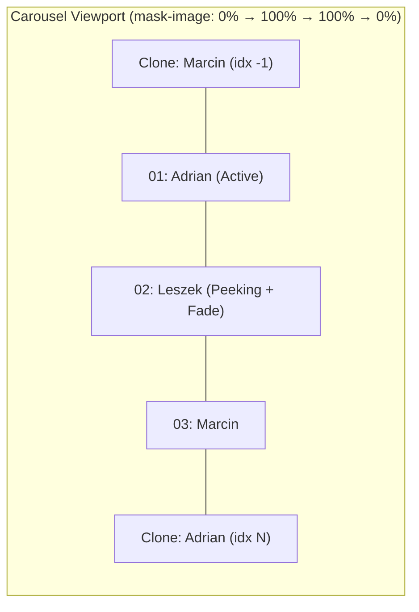

# Mobile Infinite Team Carousel Implementation Plan

## Goal Description

Transform the **Team (`#team`)** section on mobile (and single-column tablet viewports) from a tall vertical stack of 3 founder cards into an **auto-scrolling, infinite horizontal carousel** with:
1. **True Infinite Loop (`0 → 1 → 2 → 0 → ...` & reverse)**: Uses cloned sentinel cards (`[last, ...founders, first]`) so both automatic horizontal scrolling and manual navigation glide continuously in one direction without snapping back across the track.
2. **Fade to `0%` Opacity at Viewport Edges**: Applies a horizontal alpha mask (`mask-image` / `-webkit-mask-image` fading to `0%` opacity at the left/right edges) paired with a peeking adjacent card (`~84%` card width) and subtle inactive-card opacity/scale recession (`opacity: 0.45`, `scale(0.95)`), visually inviting horizontal exploration.
3. **Unmistakable Click & Tap Affordances**:
   - **Interactive Teammate Switcher Pills**: A compact horizontal control bar above the track showing each founder's avatar thumbnail + first name (or index pill) with an animated **auto-scroll progress fill** inside the active pill, plus `$control-height: 32px` glassmorphic **Prev (`‹`) / Next (`›`)** buttons.
   - **Clickable Peeking Cards**: Tapping the partially visible next/previous card on the right/left edge immediately advances the carousel to that teammate.
   - **Touch Swipe & Auto-Pause**: Native-feeling horizontal pointer/touch drag support; auto-scroll pauses automatically while the user touches, hovers, or focuses inside the carousel and resumes cleanly afterward.

---

## Open Questions

> [!IMPORTANT]
> 1. **Breakpoint Scope**: Currently `.team-grid` collapses from 3 columns to 1 column at the `tablet` breakpoint (`≤ 960px`). Should the infinite horizontal carousel activate on **`mobile` only (`≤ 640px`)** or on **both `tablet` and `mobile` (`≤ 960px`)** wherever the 3-column desktop grid no longer fits? (Default in plan: `mobile` + `tablet` via `bp.tablet()`, keeping the 3-column static grid on desktop `> 960px`).
> 2. **Auto-Scroll Motion Style**: Do you prefer **interval-based step auto-scroll** (pauses on each teammate for `4.5s` with a visible progress bar filling up, then smoothly glides to the next teammate so bios remain easy to read) or **continuous slow marquee drift** that stops when tapped/hovered? (Default in plan: **Interval step auto-scroll (`4.5s`) with live progress indicator**, as founder cards contain 100-word bios).

---

## Architecture & Infinite Loop Mechanics



- **Track Layout**: On mobile/tablet, `.team-carousel__viewport` renders 5 slides for the 3 founders: `[founders[2], founders[0], founders[1], founders[2], founders[0]]`.
- **Seamless Wrap-Around**:
  - Advancing from `founders[2]` (track index `3`) animates smoothly to `CloneFirst` (track index `4`).
  - Once the `450ms cubic-bezier(0.22, 1, 0.36, 1)` CSS transition ends (`transitionend`), the track silently resets `isTransitioning = false` and snaps `trackIndex` to `1` (`founders[0]`) on the same frame—producing a seamless infinite loop.
  - Stepping backward from `founders[0]` (track index `1`) animates to `CloneLast` (track index `0`), then silently resets to `3` (`founders[2]`).

---

## Proposed Changes

### 1. Internationalization (`src/app/core/i18n/`)

Per `AGENTS.md` Rule #4 (Zero Hardcoded Strings), add accessible ARIA labels for the carousel controls to `Dict` and both locale dictionaries.

#### [MODIFY] [i18n.types.ts](file:///workspace/src/app/core/i18n/i18n.types.ts)
Add carousel accessibility keys under the `// Team Section` block:
```ts
  // Team Section
  teamKicker: string;
  teamTitle: string;
  teamLead: string;
  teamLeads: string[];
  teamRefs: TeamRef[];
  teamFocusLabel: string;
  teamPrevAria: string;
  teamNextAria: string;
  teamSelectAria: string;
  founders: FounderEntry[];
```

#### [MODIFY] [en.ts](file:///workspace/src/app/core/i18n/en.ts) & [pl.ts](file:///workspace/src/app/core/i18n/pl.ts)
Add English and Polish translations for `teamPrevAria`, `teamNextAria`, and `teamSelectAria`.

---

### 2. Carousel State, Auto-Scroll Timer & Gesture Logic

#### [MODIFY] [app.component.ts](file:///workspace/src/app/app.component.ts)
- Import `ChevronLeft` and `ChevronRight` from `lucide-angular`.
- Add reactive signals and lifecycle cleanup for the mobile infinite team carousel:
  - `activeTeamIndex = signal(0)` (`0..founders.length - 1`)
  - `teamTrackIndex = signal(1)` (`0..founders.length + 1`, accounting for leading/trailing clones)
  - `teamTransitionEnabled = signal(true)`
  - `teamPaused = signal(false)`
  - `teamDragOffsetPx = signal(0)`
  - `teamSlides = computed(...)` returning `[last, ...founders, first]` when carousel mode is active.
- **Auto-Scroll Timer**:
  - Runs outside Angular zone (`setInterval` every `4500ms`) when `bp.mobile()` (or `bp.tablet()`) is true, `!teamPaused()`, and `!isReducedMotion()`.
  - Calls `nextTeammate()` to advance infinitely.
- **Manual Controls & Touch Swiping**:
  - `selectTeammate(index: number)`: jumps smoothly to the selected founder and resets the auto-scroll timer.
  - `prevTeammate()` / `nextTeammate()`: increments/decrements `teamTrackIndex` with wrap-around guard.
  - `onTeamTrackTransitionEnd()`: silently teleports from sentinel clone index `0` → `N` or `N + 1` → `1` with `teamTransitionEnabled.set(false)` before re-enabling transitions on the next animation frame.
  - `onTeamPointerDown` / `onTeamPointerMove` / `onTeamPointerUp`: tracks horizontal swipe delta so users can flick left/right or tap a peeking card to advance.

---

### 3. Template & Click Affordances

#### [MODIFY] [app.component.html](file:///workspace/src/app/app.component.html)
- Keep the existing desktop 3-column `.team-grid` when `!bp.tablet()` (or style a unified structure where mobile/tablet activates the carousel wrapper).
- On mobile/tablet, render:
  1. **Interactive Teammate Switcher Bar (`.team-carousel__controls`)**:
     - Left/Right `$control-height: 32px` glassmorphic icon buttons (`‹` / `›`).
     - Clickable founder selector pills displaying each founder's circular avatar + first name (`Adrian`, `Leszek`, `Marcin`) and a bottom/background progress bar that fills over `4.5s` in KMD Orange (`#d37400`) on the active teammate.
  2. **Edge-Faded Infinite Viewport (`.team-carousel__viewport`)**:
     - Wraps `.team-carousel__track` translated by `calc(-1 * teamTrackIndex() * var(--team-slide-step) + teamDragOffsetPx())`.
     - Clicking an adjacent/peeking card (`slideIndex !== teamTrackIndex()`) triggers `prevTeammate()` or `nextTeammate()` directly.

---

### 4. Styling, `0%` Edge Opacity Mask & Peeking Cards

#### [MODIFY] [app.component.scss](file:///workspace/src/app/app.component.scss)
- Use `@include respond-to("tablet")` and `@include respond-to("mobile")` (never hardcoded `@media` pixel widths).
- **Fade to `0%` Opacity Mask**:
  ```scss
  .team-carousel__viewport {
    position: relative;
    overflow: hidden;
    margin: 24px -16px 0;
    padding: 8px 0 20px;
    mask-image: linear-gradient(
      to right,
      transparent 0%,
      #000 7%,
      #000 86%,
      transparent 100%
    );
    -webkit-mask-image: linear-gradient(
      to right,
      transparent 0%,
      #000 7%,
      #000 86%,
      transparent 100%
    );
  }
  ```
- **Peeking Card Geometry & Inactive Fade**:
  - Each slide occupies `--team-slide-width: 82%` with a `14px` gap (`--team-slide-step`), centered so the active card sits prominently on screen while the next teammate's card peeks in on the right and fades smoothly into `0%` opacity at the viewport edge.
  - Non-active slides also apply `opacity: 0.45; transform: scale(0.95); cursor: pointer;` transitioning to `opacity: 1; transform: scale(1);` when active.
- **Switcher Pill Progress Bar**:
  - Active founder pill highlights with `color("accent")` border and an animated fill bar (`@keyframes teamAutoProgress` `0% → 100%` over `4.5s`, paused when `.is-paused`).

---

## Verification Plan

### Automated Verification
- Run `npm run build` to verify TypeScript type safety (including `Dict` parity across `en.ts` and `pl.ts`) and SCSS compilation without errors or warnings.

### Manual Verification
1. Resize viewport to mobile (`≤ 640px`, e.g., `390 × 844`) and scroll to `#team`.
2. Verify that the active teammate card is framed clearly while the next teammate's card peeks in from the right and fades to `0%` opacity at the viewport edge.
3. Observe automatic horizontal scrolling every `4.5s` (`Adrian → Leszek → Marcin → Adrian`) and confirm that wrapping from `Marcin` to `Adrian` continues smoothly to the right (infinite loop) without snapping backward.
4. Click the **founder switcher pills**, the **Prev/Next (`‹`/`›`) buttons**, and **tap directly on the peeking card** on the right edge to verify manual navigation and auto-timer reset.
5. Switch language between `EN` and `PL` in the top-left HUD to confirm all labels and ARIA attributes update reactively.
