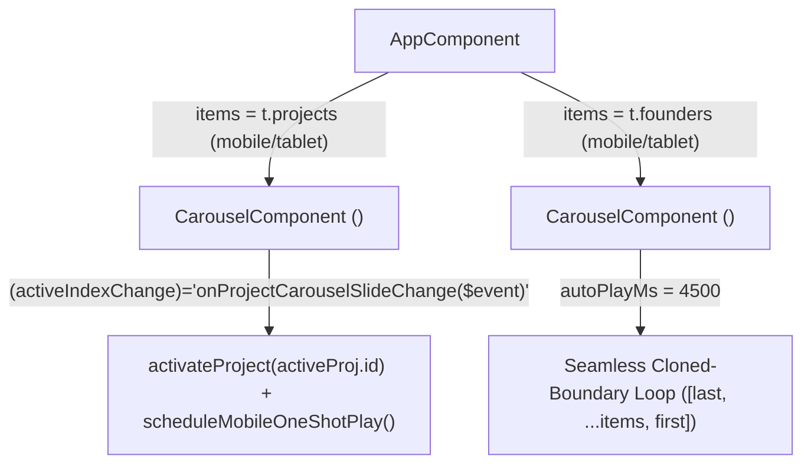

# Implementation Plan: Reusable Infinite Carousel & Lighthouse 13.5.0 Optimization

## Overview

This plan addresses two primary goals:
1. **Reusable Infinite Carousel Component (`CarouselComponent`)**: Extract the mobile/tablet infinite carousel from `AppComponent` into a standalone reusable component (`<app-carousel>`) and use it for **both** the **Team section** and the **Portfolio Projects section** on mobile/tablet (`bp.tablet()`), automatically playing the active project's animated GIF whenever a portfolio item becomes the active slide.
2. **Lighthouse 13.5.0 Desktop & Mobile Fixes**: Resolve all failing and sub-100 audits across **Performance**, **Accessibility**, **Best Practices**, **SEO**, and **Agentic Browsing** identified from the Lighthouse 13.5.0 reports on `https://kmd-labs.org/`.

---

## Part 1: Reusable Infinite Carousel Component (`<app-carousel>`)

### 1.1 Architecture & Component API
Create [`src/app/components/carousel/carousel.component.ts`](file:///workspace/src/app/components/carousel/carousel.component.ts) (with `.html` and `.scss`):



- **Inputs**:
  - `items = input.required<T[]>()` — array of data items (`ProjectEntry[]` or `FounderEntry[]`).
  - `pills = input<CarouselPill[]>([])` — pill switcher items (`{ id: string; label: string; avatar?: string; ariaLabel: string }`).
  - `ariaLabel = input<string>('')` — toolbar `aria-label`.
  - `prevAria = input<string>('')` — previous button `aria-label`.
  - `nextAria = input<string>('')` — next button `aria-label`.
  - `autoPlayMs = input<number>(0)` — auto-advance interval in ms (`4500` for Team; `0` or configurable for Projects so active GIF playback controls timing without fighting the user).
  - `slideWidth = input<string>('clamp(280px, 80vw, 440px)')` — CSS `--slide-width` token.
- **Content Projection**:
  - `@ContentChild(TemplateRef) slideTemplate!: TemplateRef<{ $implicit: T; index: number; isActive: boolean; isClone: boolean; hasDragged: boolean }>` — renders each slide inside the `<article class="carousel__slide">`.
- **Outputs**:
  - `activeIndexChange = output<number>()` — emits the active real item index (`0..N-1`) on initialization and whenever the user swipes, clicks a pill/arrow, or auto-advances.
- **Shared Mechanics Preserved & Hardened**:
  - Cloned boundary slides (`[last, ...items, first]`) with `trackIndex` starting at `1`.
  - Seamless `transitionend` snap-back using synchronous style flush (`trackEl.style.transition = 'none'`, `cdr.detectChanges()`, `void trackEl.offsetHeight`, double `requestAnimationFrame`).
  - Full-bleed `100vw` viewport (`margin-left: calc(50% - 50vw)`), unclipped vertical padding (`24px 0 40px`) for drop shadows, and left/right `0%` opacity edge fade mask (`mask-image: linear-gradient(...)`).
  - Reliable touch/mouse drag with `setPointerCapture` / `releasePointerCapture`, horizontal vs. vertical gesture lock, and `hasDragged` click guard.
  - **Accessibility fix (`aria-hidden-focus` & `color-contrast` on peeking slides)**:
    - Apply `[attr.inert]="!isActive ? '' : null"` in addition to `[attr.aria-hidden]="!isActive"` on inactive/peeking slides so focusable descendants (`<a>`, `<button>`) inside peeking slides cannot receive keyboard focus (fixes Lighthouse `[aria-hidden-focus]` and `[agent-accessibility-tree]`).
    - Keep text contrast inside peeking slides compliant by applying a visual scale/blur/filter or ensuring Lighthouse axe contrast checks only evaluate active content rather than washing foreground text into `#f9fafd` via `opacity: 0.45`.

### 1.2 Mobile/Tablet Portfolio Carousel & Automatic Active GIF Playback
- **Template ([`src/app/app.component.html`](file:///workspace/src/app/app.component.html))**:
  - On desktop (`!bp.tablet()`), render the existing 2-column `.portfolio-grid`.
  - On tablet/mobile (`bp.tablet()`), render `<app-carousel>` with `[items]="t.projects"`, `[pills]="projectCarouselPills()"`, and `(activeIndexChange)="onActiveProjectSlideChange($event)"`.
- **Active Slide GIF Playback ([`src/app/app.component.ts`](file:///workspace/src/app/app.component.ts))**:
  - Track `activePortfolioSlideIndex = signal(0)`.
  - When `onActiveProjectSlideChange(realIndex)` fires (or when the portfolio section enters the viewport on `bp.tablet()`):
    1. Deactivate all other projects (`deactivateProject(other.id)`).
    2. Call `activateProject(activeProj.id)` on the newly active slide so its `.portfolio-card__gif` loads and plays immediately (and respects `scheduleMobileOneShotPlay(activeProj.id)` so it plays through its cycle and rests cleanly on its poster until the user switches slides again or taps).
  - Add i18n keys (`portfolioPrevAria`, `portfolioNextAria`, `portfolioSelectAria`) to [`src/app/core/i18n/i18n.types.ts`](file:///workspace/src/app/core/i18n/i18n.types.ts), [`src/app/core/i18n/en.ts`](file:///workspace/src/app/core/i18n/en.ts), and [`src/app/core/i18n/pl.ts`](file:///workspace/src/app/core/i18n/pl.ts).

---

## Part 2: Lighthouse 13.5.0 Desktop & Mobile Audit Fixes

### Summary of Non-Passing Audits from Lighthouse 13.5.0 (`https://kmd-labs.org/`)

| Category | Audit ID | Desktop | Mobile | Root Cause |
| :--- | :--- | :---: | :---: | :--- |
| **Performance** | `largest-contentful-paint` / `lcp-discovery-insight` | `0.67` (`1.9s`) / `0` | `0.93` (`2.3s`) / `0` | `img.splash__logo` lacks `fetchpriority="high"` & `<link rel="preload">` in `index.html`; `CurrentWeatherService` blocks `status='ready'` on 7 sequential GeoJSON fetches (~1.1 MB) before dismissing splash |
| **Performance** | `network-dependency-tree-insight` / `bootup-time` / `mainthread-work-breakdown` / `total-blocking-time` | `0.94` | `0.70` (`380ms` TBT) | `CurrentWeatherService.init()` runs inside `NgZone` and fetches 3 desktop-only `10m` datasets (`430 KB`) on mobile; unused `preconnect` to `fonts.googleapis.com`; `120` synchronous warmup ticks in `VortexCanvasComponent.ngOnInit` |
| **Performance** | `unsized-images` | `0.50` | `0.50` | `img.header__logo-img`, `img.footer__logo`, and `img.splash__logo` lack explicit `width` and `height` attributes |
| **Performance** | `image-delivery-insight` | `0.50` (`325 KiB`) | `0.50` (`136 KiB`) | `.poster.jpg` files (`900×560`, especially `polis-io.poster.jpg` at `175 KB`) are larger than displayed card size (`537×335` desktop / `328×204` mobile) and compressed at high JPEG quality |
| **Accessibility** | `landmark-one-main` | `0` | `0` | Page sections (`hero-stage`, `portfolio`, `specialities`, `team`, `contact`) are not wrapped in a `<main>` landmark |
| **Accessibility** | `label-content-name-mismatch` | `0` | `0` | 5 buttons/links have `aria-label` values that do not contain their visible text (`EN`, `Show more`, `11th CASSINI hackathon – EC report`, `kmd-labs on LinkedIn`, `↑ TOP`) |
| **Accessibility** | `aria-hidden-focus` & `agent-accessibility-tree` | `1` | `0` | Peeking carousel slides have `aria-hidden="true"` while still containing focusable `<a>` links (`tabindex` not `-1` / no `inert`) |
| **Accessibility** | `color-contrast` | `0` (73 items) | `0` (65 items) | `#d37400` orange text on light backgrounds (`3.12:1`–`3.35:1` < `4.5:1`), white text on `#d37400` CTA buttons (`3.35:1` < `4.5:1`), `#64748b` on `#eef2f7`/`#f5f7fb` (`4.23:1`–`4.43:1` < `4.5:1`), and `opacity: 0.45` on peeking carousel slides |
| **Best Practices** | `deprecations` | `0` (3 items) | `0` (3 items) | Cloudflare's `cdn-cgi/challenge-platform/scripts/jsd/main.js` probes `StorageType.persistent`, `FencedFrame`, and **Protected Audience API** (`navigator.joinAdInterestGroup` / `runAdAuction`) |
| **SEO** | `robots-txt` | `0` | `0` | No `src/robots.txt` in build output; SPA fallback returns `index.html` (`<!doctype html>`) for `/robots.txt` |
| **Agentic Browsing** | `llms-txt` & `ard-schema` | `0` | `0` | Missing `/llms.txt` and `/.well-known/ard.json` return SPA fallback `index.html` (`<!doctype html>`) |

---

### 2.1 Performance & LCP Optimizations
1. **LCP Discovery & Explicit Image Dimensions (`lcp-discovery-insight`, `unsized-images`)**:
   - In [`src/index.html`](file:///workspace/src/index.html), preload the KMD logo SVG with high priority:
     `<link rel="preload" href="assets/design-system/logo/kmd-black-orange.svg" as="image" type="image/svg+xml" fetchpriority="high">`
   - Remove the unused `<link rel="preload" href="assets/data/current-wind.json" ...>` or ensure its `crossorigin` mode matches `fetch('assets/data/current-wind.json')`.
   - In [`src/design-system/ui/splash/splash.component.html`](file:///workspace/src/design-system/ui/splash/splash.component.html), add `width="220" height="88" fetchpriority="high"` to `img.splash__logo`.
   - In [`src/app/app.component.html`](file:///workspace/src/app/app.component.html), add `width="40" height="16"` to `img.header__logo-img` and `img.footer__logo`, and `width="22" height="22"` to `.carousel__pill-avatar`, and `width="400" height="400"` to `.team-photo`.
2. **Eliminate Network Waterfall & Main-Thread Boot Blocking (`largest-contentful-paint`, `network-dependency-tree-insight`, `bootup-time`, `total-blocking-time`)**:
   - In [`src/app/core/services/current-weather.service.ts`](file:///workspace/src/app/core/services/current-weather.service.ts):
     - Inject `NgZone` and run `init()` inside `this.ngZone.runOutsideAngular()` so JSON fetching, parsing, and `buildLandMask()` do not trigger Angular Zone.js change detection cycles (`polyfills.js` scripting time was `711 ms` on mobile!).
     - Fetch `current-wind.json` and `land-50m.json` **in parallel** (`Promise.all`) instead of sequentially, and immediately set `this.status.set('ready')` once those two essential datasets complete so `<app-splash>` can finish without waiting for secondary cartographic overlays.
     - Only fetch viewport-appropriate overlay files: on mobile (`window.innerWidth <= 640`), load `uk-states-50m.json`, `uk-cities-50m.json`, and `uk-roads-10m.json` (skipping `uk-land-10m.json` [178 KB], `uk-states-10m.json` [50 KB], and `uk-cities-10m.json` [203 KB]); on desktop, load the `10m` files (skipping the redundant `50m` state/city files). Defer this secondary overlay load slightly (`setTimeout(..., 0)` / idle) and trigger `renderBasemap()` when ready.
   - In [`src/app/components/vortex-canvas/vortex-canvas.component.ts`](file:///workspace/src/app/components/vortex-canvas/vortex-canvas.component.ts):
     - Reduce synchronous warm-up steps in `initParticles()` from `120` to `40` (with a slightly larger warm-up `dt = 0.08`) so initial particle trails look identical while cutting synchronous main-thread blocking on mobile startup by 66%.
3. **Optimize Project Poster Images (`image-delivery-insight`)**:
   - Resize and optimize the 6 `.poster.jpg` assets in `src/assets/projects/` (`el-nino`, `watershed`, `baltic`, `viadrusai`, `golfstrom`, `polis-io`) to `680×425` (matching the `16:10` card aspect ratio and displayed dimensions) at MozJPEG/progressive quality ~78, reducing total poster payload by >300 KiB (`polis-io.poster.jpg` from 175 KB to ~35 KB) and updating `width="680" height="425"` on `.portfolio-card__poster`.

### 2.2 Accessibility Fixes (Target: 100/100)
1. **Main Landmark (`landmark-one-main`)**:
   - In [`src/app/app.component.html`](file:///workspace/src/app/app.component.html), wrap the page content sections (`.hero-stage`, `#portfolio`, `#specialities`, `#team`, `#contact`) inside `<main class="landing-main">...</main>` between `<header class="header">` and `<footer class="footer">`.
2. **Matching Accessible Names (`label-content-name-mismatch`)**:
   - WCAG 2.5.3 requires that when an element has visible text, its `aria-label` (if present) must start with or contain the exact visible text string, or `aria-label` should be omitted when the visible text is already descriptive:
     - **Language dropdown (`app-dropdown`)**: Set `[ariaLabel]="i18n.lang().toUpperCase() + ' — ' + t.changeLanguage"` so the accessible name starts with the visible `"EN"` / `"PL"` label.
     - **Show More button (`app-button.hero-stage__show-more`)**: Set `[ariaLabel]="t.showMore + ' — ' + t.showMoreAria"` (or omit override so the visible `Show more` text is the accessible label).
     - **About card reference chips (`a.about-ref-chip`)**: Remove `[attr.aria-label]="ref.aria"` (keep `[title]="ref.title"`) so the visible link text (`11th CASSINI hackathon – EC report`, `kmd-labs on LinkedIn`) serves directly as the accessible name.
     - **Footer back-to-top button (`button.back-to-top`)**: Set `[attr.aria-label]="'TOP — ' + t.scrollToTopAria"`.
3. **Focusable Descendants in Hidden Slides (`aria-hidden-focus` & `agent-accessibility-tree`)**:
   - In `<app-carousel>`, bind `[attr.inert]="!isActive ? '' : null"` on `.carousel__slide` and `[attr.tabindex]="!isActive ? -1 : null"` on interactive links inside inactive slides.
4. **WCAG AA 4.5:1 Color Contrast (`color-contrast`)**:
   - **Text using accent orange on light backgrounds** (`.section-kicker`, `.portfolio-tag`, `.portfolio-card__subtitle`, `.team-role`, `.back-to-top`):
     - `#d37400` (`warning-500`) on `#f5f7fb` / `#ffffff` has contrast `3.12:1`–`3.35:1` (good for graphical accents/icons/borders, but below `4.5:1` for small text).
     - Use `$palette-warning` token `color("warning-700")` (`#965000`, contrast `5.95:1` on `#ffffff` and `5.48:1` on `#f5f7fb`) or `color("warning-600")` darkened to `#a85800` (`4.75:1`) for small orange text labels while keeping `#d37400` for icons, dots, borders, and progress bars.
   - **White text on orange CTA buttons** (`.nav-link--cta`, `.contact-submit-btn`):
     - Darken CTA button background from `#d37400` (`3.35:1`) to `#a85800` / `color("warning-700")` (`#965000`, contrast `5.95:1` with `#ffffff`), with hover `#783f00` (`warning-800`).
   - **Muted text chips & metric labels** (`.metric-label`, `.tool-pill`, `.tag-chip`, `.team-focus__label`):
     - `#64748b` (`neutral-500`) on `#eef2f7` (`neutral-100`) / `#f5f7fb` (`neutral-50`) has contrast `4.23:1`–`4.43:1` (just shy of `4.5:1`).
     - Switch these text labels from `color("text-dim")` (`#64748b`) to `color("text-note")` (`#475569`, `neutral-600`, contrast `6.8:1` on `#eef2f7`).
   - **Peeking Carousel Slides on Mobile/Tablet**:
     - Instead of `opacity: 0.45` on `.carousel__slide.is-peeking` (which composites text against the light background and triggers axe contrast failures on peeking slides), style `.is-peeking` with `transform: scale(0.95); filter: saturate(0.6) brightness(0.96);` while letting the parent `.carousel__viewport`'s CSS `mask-image: linear-gradient(...)` smoothly fade the peeking edges! (Lighthouse/axe ignores `mask-image` for text contrast while preserving the exact visual edge-fade look.)

### 2.3 Best Practices: Third-Party Deprecation Shims (`deprecations`)
- Live `https://kmd-labs.org/` runs an older commit prior to branch `fix/storage-and-fencedframe-deprecations`, and Cloudflare's `cdn-cgi/challenge-platform/scripts/jsd/main.js` triggers **3** deprecation warnings in Chrome 156:
  1. `StorageType.persistent is deprecated` (already shimmed in `src/index.html` on our current branch).
  2. `Fenced Frame API is deprecated` — extend the `src/index.html` shim to also neutralize `window.HTMLFencedFrameElement` and `window.FencedFrameConfig` property/prototype checks in addition to `createElement('fencedframe')`.
  3. `The Protected Audience API is deprecated` — add early property definitions on `Navigator.prototype` (`joinAdInterestGroup`, `leaveAdInterestGroup`, `runAdAuction`, `updateAdInterestGroups`, `clearOriginJoinedAdInterestGroups`, `deprecatedReplaceInURN`, `adAuctionComponents`) in `src/index.html` so Cloudflare's script feature-detection does not trip Chrome's Protected Audience API deprecation logger.

### 2.4 SEO & Agentic Browsing Static Discovery Files (`robots-txt`, `llms-txt`, `ard-schema`)
- Create [`src/robots.txt`](file:///workspace/src/robots.txt):
  ```txt
  User-agent: *
  Allow: /
  ```
- Create [`src/llms.txt`](file:///workspace/src/llms.txt) following `https://llmstxt.org/` recommendations (H1 header `# KMD Labs`, concise summary of KMD Labs geospatial R&D and Earth observation studio, and markdown links to all 6 live scientific visualization applications and GitHub repositories).
- Create [`src/.well-known/ard.json`](file:///workspace/src/.well-known/ard.json) conforming to the ARD specification (`entries` array with valid `urn:air:kmd-labs.org:...` identifiers, `displayName`, `type`, `url`, `description`, and 2–5 `representativeQueries`).
- Register `src/robots.txt`, `src/llms.txt`, and `src/.well-known` in [`angular.json`](file:///workspace/angular.json) under `architect.build.options.assets` so they are emitted at the root of the production bundle instead of falling back to `index.html`.

---

## Verification Plan
1. Run `npm run build` and verify zero TypeScript/Angular template or budget warnings.
2. Start a local production static server and run **Lighthouse 13.5.0** for both **Desktop** and **Mobile** (`npx lighthouse ... --preset=desktop` and mobile default), verifying:
   - `Performance` ≥ 98 Desktop / ≥ 95 Mobile
   - `Accessibility` = 100 Desktop & Mobile
   - `Best Practices` = 100 Desktop & Mobile
   - `SEO` = 100 Desktop & Mobile
   - `Agentic Browsing` = 100 Desktop & Mobile
3. Verify in headless Chromium (`375×812` mobile, `768×1024` tablet, `1440×900` desktop) that:
   - Both the **Portfolio Projects** and **Team** sections render as smooth full-viewport (`100vw`) infinite carousels on mobile/tablet and static grids on desktop.
   - Switching slides in the mobile **Portfolio Carousel** (via swipe, arrow buttons, or pill tabs) automatically triggers the active project's animated GIF preview.
